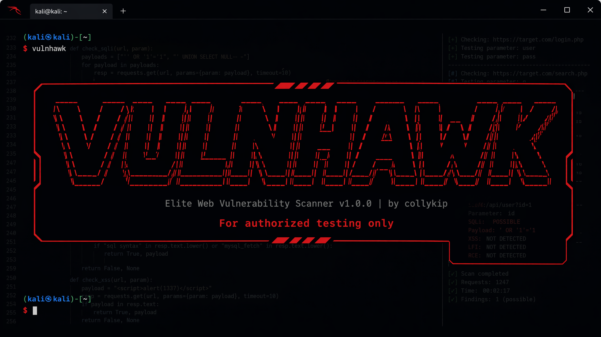
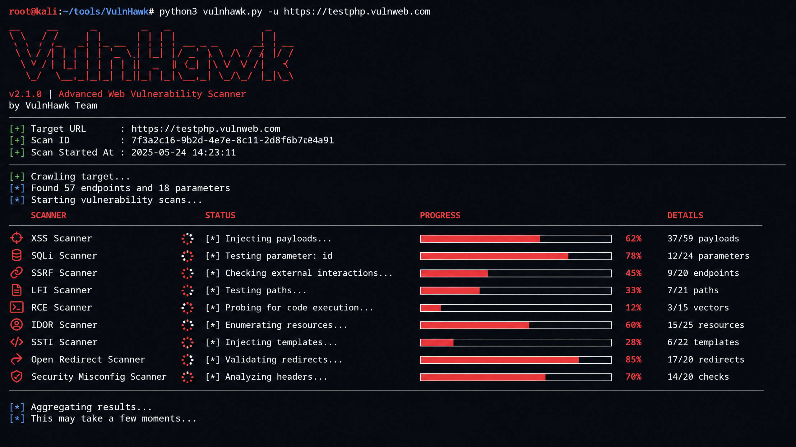
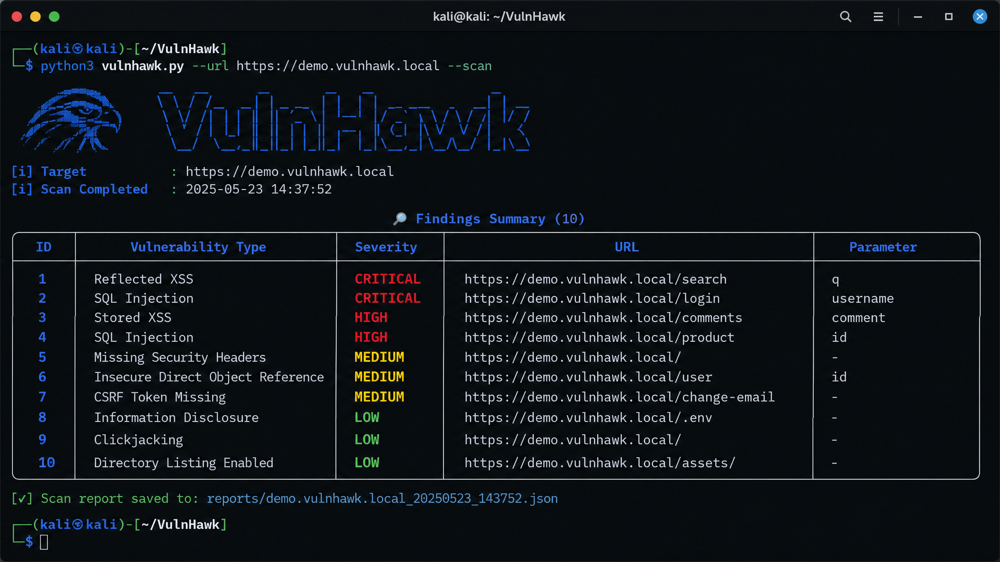
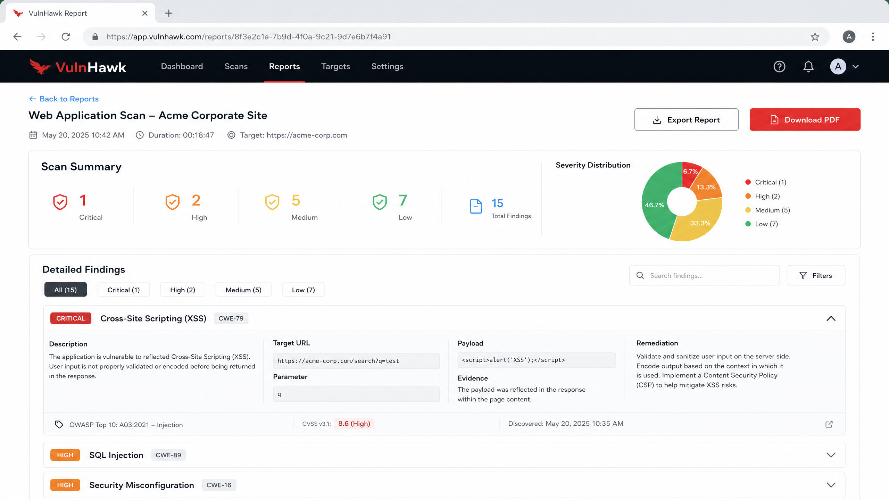
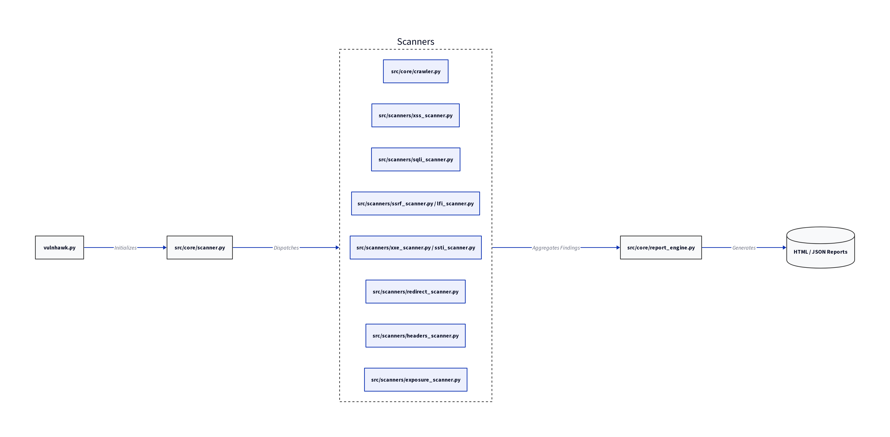

⚠️ LEGAL DISCLAIMER ⚠️
================================================================================
VulnHawk is a security testing tool designed for EDUCATIONAL PURPOSES and
AUTHORIZED SECURITY TESTING ONLY.

By using this software, you agree to:
- ONLY scan systems you own or have explicit written permission to test
- Comply with all applicable laws and regulations
- Accept full responsibility for your actions
- NOT use this tool for illegal or unauthorized activities

The authors assume NO LIABILITY for misuse, damage, or legal consequences
resulting from the use of this software.

USE RESPONSIBLY. STAY LEGAL. BE ETHICAL.
================================================================================

# VulnHawk 🦅

[](https://github.com/Colly-dev/VulnHawk/actions/workflows/ci.yml)
[](https://opensource.org/licenses/MIT)
[](https://www.python.org/downloads/release/python-3100/)

**VulnHawk** is a production-grade, Python-powered web application vulnerability scanner demonstrating offensive security, AppSec, and automated vulnerability assessment capabilities. It is suitable for a cybersecurity portfolio, GitHub showcase, and AppSec / penetration tester job applications.

## 📸 Screenshots

### Terminal Banner

*The professional red-themed startup banner and legal disclaimer.*

### Scan in Progress

*Live vulnerability scanning with concurrent progress tracking for each module.*

### Findings Table

*A detailed summary of identified vulnerabilities, color-coded by severity.*

### HTML Report

*A comprehensive, professional HTML report generated after the scan for stakeholders.*

## 🚀 Overview

VulnHawk provides a complete pipeline for web vulnerability assessment:
- **Web Crawling**: Discovers endpoints and parameters within target applications.
- **Vulnerability Scanning**: Detects common web vulnerabilities (XSS, SQLi, SSRF, LFI, XXE, SSTI, Open Redirects, Sensitive Data Exposure, Missing Security Headers).
- **CVSS Scoring**: Scores findings using CVSS 3.1 for standardized severity assessment.
- **PoC Generation**: Produces proof-of-concept exploit examples (curl, Python scripts).
- **WAF Detection**: Identifies Web Application Firewalls (WAFs).
- **Reporting**: Generates professional HTML and JSON reports.
- **Concurrency**: Utilizes `asyncio` for efficient and fast scanning.

## 🏗️ Architecture

VulnHawk orchestrates a complete **9-step Vulnerability Scanning Workflow**:
1. **Target Discovery and Validation**
2. **Web Crawling and Enumeration**
3. **Parameter Detection**
4. **Vulnerability Scanning**
5. **Payload Injection**
6. **Response Analysis**
7. **Vulnerability Confirmation**
8. **CVSS Scoring**
9. **Report Generation**

### Architecture Diagram


Full architecture documentation:
[docs/architecture/architecture.md](docs/architecture/architecture.md)

---

## 🎥 Demo Video
[](demo/demo_video_link.txt)

## 🛠️ Installation

### Prerequisites
- **Python 3.10+**
- **Git**

### Setup & OS-Specific Instructions

#### 1. Clone the Repository
```bash
git clone https://github.com/Colly-dev/VulnHawk.git
cd VulnHawk
```

#### 2. Create and Activate Virtual Environment

| Operating System | Command |
|------------------|---------|
| **Windows (CMD)** | `python -m venv venv` <br> `venv\Scripts\activate` |
| **Windows (PowerShell)** | `python -m venv venv` <br> `.\venv\Scripts\Activate.ps1` |
| **Linux / macOS** | `python3 -m venv venv` <br> `source venv/bin/activate` |

#### 3. Install Dependencies
Regardless of your OS, once the virtual environment is activated, run:
```bash
pip install -r requirements.txt
```

> **Note for Linux Users**: You might need to install `python3-venv` first if it's not present: `sudo apt install python3-venv`.

## 📖 Usage

VulnHawk provides a comprehensive CLI:

- **Basic Scan**:
  ```bash
  python vulnhawk.py -u https://example.com
  ```
- **Scan all vulnerabilities and generate HTML report**:
  ```bash
  python vulnhawk.py -u https://example.com --scan all --report html
  ```
- **Scan specific vulnerabilities (XSS and SQLi) and generate JSON report**:
  ```bash
  python vulnhawk.py -u https://example.com --scan xss,sqli --report json
  ```
- **Verbose output**:
  ```bash
  python vulnhawk.py -u https://example.com -v
  ```

## 🧪 Testing and Demonstration

If you do not have a live target to scan, you can use these commands to test the tool's interface, progress bars, and report generation capabilities.

### 1. Test the Startup Banner and Legal Disclaimer
Simply run the tool without a target to see the professional red banner and interactive legal notice:
```bash
python vulnhawk.py -u http://localhost:8000
```

### 2. Simulate a Full Scan
Run a full scan against a local or mock address to observe the `rich`-powered progress bars and terminal output:
```bash
python vulnhawk.py -u http://example.com --scan all --report all -v
```

### 3. Generate Sample Reports
After running a scan (even against a mock target), check the `reports/` directory to see the generated professional HTML and JSON reports:
- **HTML Report**: `reports/html/example_com_report.html`
- **JSON Report**: `reports/json/example_com_report.json`

### 4. Verify Payload Loading
You can verify that the scanner correctly loads payloads from the `payloads/` directory by checking the logs:
```bash
tail -f logs/vulnhawk.log
```

## 📄 License
This project is licensed under the MIT License - see the [LICENSE](LICENSE) file for details.

## 👤 Author
Created by **Colly-dev** for cybersecurity portfolio and educational purposes.
