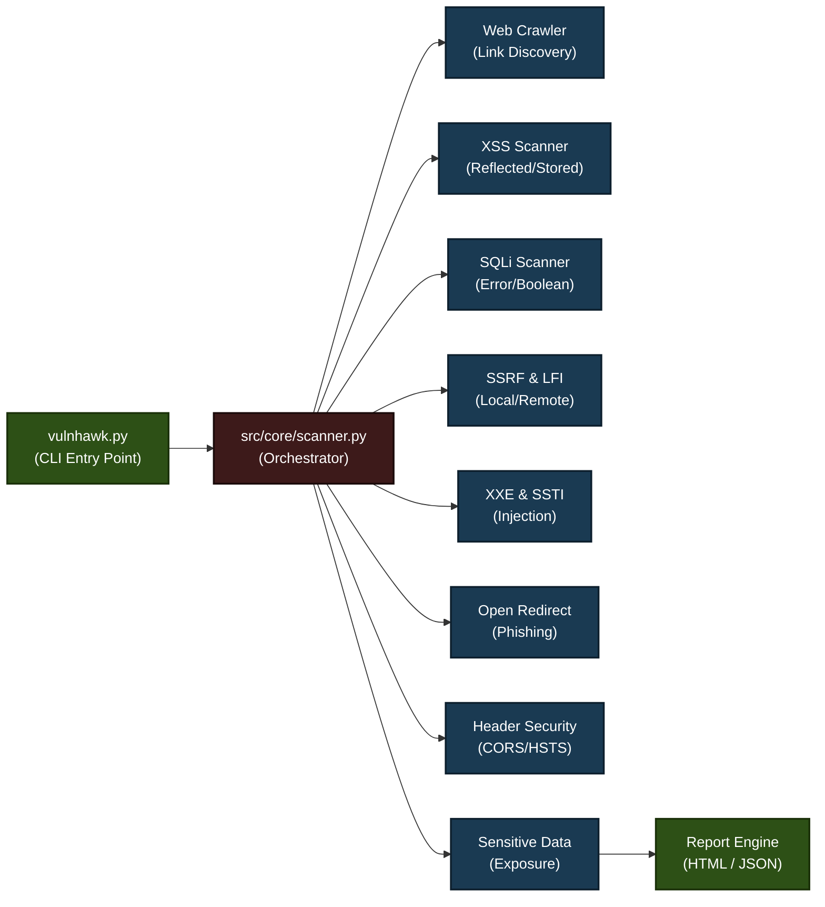

# VulnHawk Architecture

## Architecture Overview

**VulnHawk** is a comprehensive security vulnerability scanner with the following components:

### Entry Point
- **vulnhawk.py** - Command-line interface entry point

### Core Orchestrator
- **src/core/scanner.py** - Central orchestrator that manages all scanning modules

### Security Scanners
1. **Web Crawler** - Discovers and crawls links
2. **XSS Scanner** - Detects reflected and stored XSS vulnerabilities
3. **SQLi Scanner** - Identifies SQL injection via error-based and boolean techniques
4. **SSRF & LFI** - Detects server-side request forgery and local file inclusion
5. **XXE & SSTI** - Scans for XML external entity and server-side template injection
6. **Open Redirect** - Identifies open redirect vulnerabilities
7. **Header Security** - Checks CORS and HSTS configurations
8. **Sensitive Data** - Detects exposed sensitive information

### Report Generation
- **Report Engine** - Outputs findings in HTML and JSON formats
